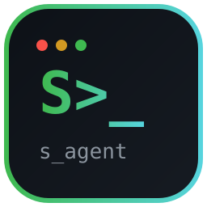

<p align="center">
  
</p>

<h1 align="center">s_agent</h1>
<p align="center"><b>A fast, hands-on coding agent for your terminal.</b><br/>Reads your codebase, edits files, runs commands and tests, drives a real browser, controls desktop apps, and verifies its own work.</p>

<p align="center">
  
  
  
  
  
</p>

```
  ____     _____   ____ _____ _   _
 / ___|   |_   _| / ___| ____| \ | |_
 \___ \  _  | |  | |  _|  _| |  \| __|
  ___) || |_| |  | |_| | |___| |\  |_
 |____/  \__, |   \____|_____|_| \_(_)
         |___/
```

## Why s_agent?

- **Zero required dependencies** — the core is pure stdlib, installs instantly, ~20 MB RAM.
- **Parallel by design** — independent tool batches run together, not one by one.
- **Offline-ready local engine** — works with no API key and no internet (instant heuristic planner); plug in any LLM when you want to.
- **Bilingual** — understands English and Arabic tasks.
- **Real browser + real desktop** — Playwright (Firefox-first) and PyAutoGUI as optional add-ons.
- **Safe by default** — blocked destructive paths/commands, confirmation prompts, desktop FAILSAFE.

## Features

| Area | What you get |
|---|---|
| Coding agent | Natural-language tasks, multi-step planning, self-verification |
| Files | `read`, `write`, `edit`, `patch`, `diff`, `ls` |
| Search & exec | Code-aware `grep`, `bash` with safety controls |
| Web | `webfetch`, `websearch` + real-browser automation |
| Browser | `open`, `text`, `click`, `fill`, `type`, `press`, `screenshot` (Firefox-first) |
| Desktop | `screenshot`, `move`, `click`, `type`, `press`, `hotkey`, `scroll`, `locate`, `windows` |
| Swarm mode | Parallel agents for decomposable goals |
| Sessions & memory | Crash-safe JSONL sessions, persistent memory, todos |
| Providers | OpenAI, Gemini, DeepSeek, OpenRouter, Ollama, LM Studio, any OpenAI-compatible API — or free local mode |

## Install

```powershell
git clone https://github.com/salim-studio/s_agent.git
cd s_agent
pip install -e .            # core only (stdlib, nothing else needed)
pip install -e ".[full]"    # + real browser & desktop control
python -m playwright install firefox
python -m s_agent doctor
```

## Usage

```bash
# Interactive session
python -m s_agent
s_agent> explain this project

# One-shot task (no confirmation prompts)
python -m s_agent run "find the main function" --yes

# Swarm mode (4 parallel agents)
python -m s_agent swarm "review this project: architecture, bugs, tests, docs" --yes

# Connect your own model (optional — local mode works without it)
python -m s_agent login

# In-session commands
/swarm <goal>  /diff  /sessions  /doctor  /exit
/browser open https://example.com  /browser shot  /desktop shot
```

## Real browser & desktop control

```bash
# Real browser — Firefox first
python -m s_agent browser status
python -m s_agent browser open --url https://example.com
python -m s_agent run "open https://example.com and summarize it" --yes
# Actions: open|text|click|fill|type|press|screenshot|close
# Add --headed for a visible window instead of headless

# Desktop — PyAutoGUI (FAILSAFE: move mouse to top-left corner to stop)
python -m s_agent desktop status
python -m s_agent desktop screenshot
python -m s_agent desktop click --x 500 --y 300
# Actions: status|size|screenshot|move|click|type|press|hotkey|scroll|locate|windows
```

> Without these extras everything else still works (12 stdlib tools) — `doctor` tells you what is missing instead of crashing.

## Languages

s_agent speaks **English, Arabic, French, and Spanish** — for both input and output. Tasks in any of them are understood; replies follow your UI language.

```bash
python -m s_agent lang        # show current language
python -m s_agent lang ar     # switch to Arabic (also: en, fr, es)
python -m s_agent lang fr     # Français
python -m s_agent --lang es run "lista el directorio" --yes
# In-session: /lang ar
```

## Safety

- Destructive filesystem/device targets are blocked.
- Risky shell commands are refused.
- Safe mode asks before writing, editing, or executing (use `--yes` to skip).
- Browser/desktop actions also ask for confirmation; desktop clicks need explicit coordinates and FAILSAFE is always on.
- **AI agents make mistakes.** Review important changes with `/diff` before deploying.

## How it works

```
You describe a goal
      → Understand (project + context)
      → Plan (pick actions)
      → Act (parallel tools: code, browser, desktop)
      → Verify (tests + evidence)
      → Report (what changed, what was verified, what remains)
```

---

<p align="center">© 2026 salim-slimani · MIT License</p>
